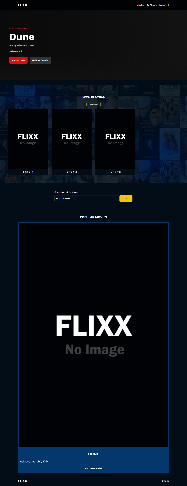
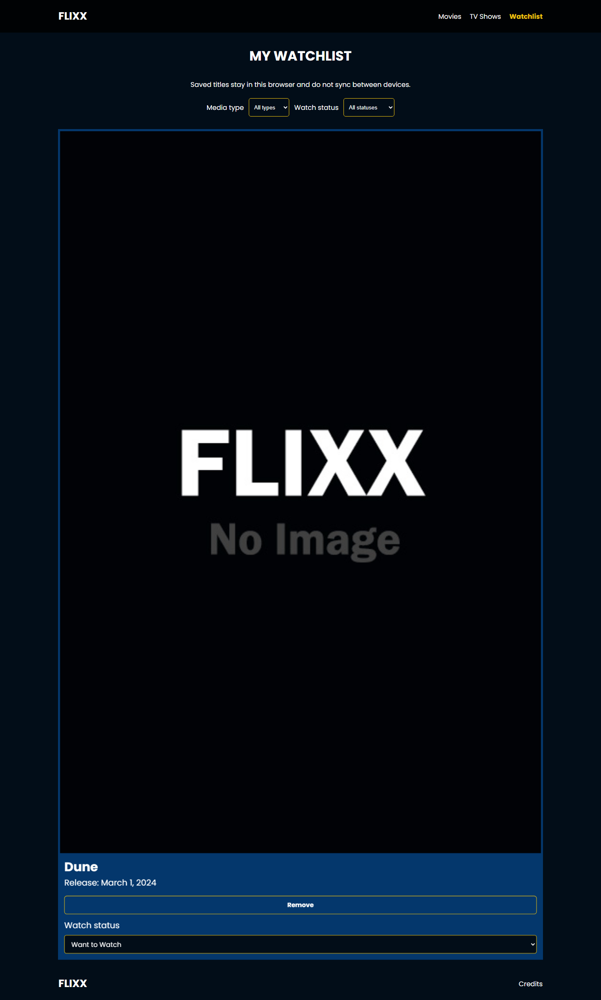

# Flixx — Movies & TV Shows

Flixx is a responsive movie and TV discovery app built with HTML, CSS, and vanilla JavaScript. It retrieves public catalog data from [The Movie Database (TMDB)](https://www.themoviedb.org/) through a small Netlify Function, keeping the TMDB credential out of browser source and requests.

## Attribution and original work

This project began as a code-along from Brad Traversy's **Modern JavaScript From the Beginning 2.0** course. Brad Traversy / Traversy Media should be credited for the original Flixx course project, including its core movie and TV listings, detail pages, search pagination, styling, and Swiper-based now-playing section.

My original additions and subsequent portfolio improvements are:

- Featured-movie hero
- Accessible YouTube trailer modal
- Netlify Function API proxy and server-side environment configuration
- Loading, error, empty, and Retry states
- Safe DOM rendering and external URL validation
- Resilient detail rendering and transactional search pagination
- Local, persistent movie/TV watchlist
- Automated unit, function, and mocked browser tests
- Accessibility and keyboard-flow improvements

TMDB supplies movie and TV data. This product uses the TMDB API but is not endorsed or certified by TMDB. Swiper and Font Awesome retain their respective licenses and attribution.

## Features

- Featured movie and trailer playback
- Now-playing slider and popular movie/TV grids
- Movie and TV detail pages with missing-data fallbacks
- Validated movie/TV search with locked pagination
- Browser-local watchlist with no account or database
- Card-level watchlist controls, Want to watch/Watched statuses, and type/status filters
- Useful loading, empty, error, and Retry states
- Responsive layout, keyboard focus treatment, reduced-motion support, slider autoplay controls, live status announcements, and safe rendering

## Screenshots

The screenshots below were captured by the mocked Playwright suite, so they show the finished interface without requiring or implying a live TMDB integration.





## Architecture

The browser calls `/.netlify/functions/tmdb`. The allowlisted proxy in `netlify/functions/tmdb.js` adds `TMDB_API_KEY` on the server, applies a timeout, checks upstream HTTP responses, and returns safe error categories. Browser ES modules under `js/` handle API requests, page controllers, rendering, validation, loading state, trailers, and watchlist storage.

The watchlist is stored only in the current browser's `localStorage`. It does not sync between browsers or devices. Existing version-1 entries are normalized in memory. If stored data is malformed, Flixx reports the problem and refuses to mutate it rather than silently overwriting data the user might want to recover.

The trailer dialog traps keyboard focus, makes the background inert while open, restores focus when closed, aborts superseded requests, and ignores late responses. Slider autoplay can be paused explicitly and starts paused when the operating system requests reduced motion.

## Local development

Requirements: Node.js 20 or newer and a free TMDB v3 API key.

```powershell
npm install
Copy-Item .env.example .env
```

Set your key in `.env`:

```dotenv
TMDB_API_KEY=your_tmdb_v3_api_key
```

Install or run the free Netlify CLI without adding it to the project runtime:

```powershell
npx netlify-cli dev
```

Open the local URL printed by Netlify CLI. A basic static file server can display the pages, but live catalog calls require the Netlify Function route.

Never place a real API key in browser JavaScript or commit `.env`. The repository tracks only `.env.example`.

## Tests and quality checks

Install Chromium once for browser tests:

```powershell
npx playwright install chromium
```

Run the checks:

```powershell
npm test
npm run test:e2e
npm run lint
npm run format:check
```

GitHub Actions runs the same lint, formatting, unit/function, and Chromium browser checks for pushes and pull requests. CI uses Node.js 22; local development supports Node.js 20 or newer.

### Mocked checks

- `npm test` runs function and browser-module tests with mocked TMDB/network responses.
- `npm run test:e2e` starts a local static test server and intercepts the Function route with deterministic mocked responses.
- These checks need no TMDB credential and do not contact TMDB.

### Live integration checks

Live TMDB integration requires a valid `TMDB_API_KEY` and `npx netlify-cli dev`. Verify the homepage, search, detail pages, trailer lookup, 404 behavior, authentication failure, rate-limit messaging, and external images/YouTube before a public launch. Automated mocked checks cannot prove current TMDB credentials, upstream availability, Netlify account configuration, or third-party media availability.

## Deploy to Netlify's free plan

1. Push the repository to a Git provider when you are ready.
2. In Netlify, choose **Add new site → Import an existing project** and select the repository.
3. Keep the production branch set to the branch you intend to publish.
4. Build command: leave blank.
5. Publish directory: `.`
6. Functions directory: `netlify/functions` (also declared in `netlify.toml`).
7. Under **Site configuration → Environment variables**, add `TMDB_API_KEY` with your TMDB v3 API key. Apply it to production and any preview contexts you intend to test.
8. Deploy, then use the live-integration checklist above. If the variable changes, trigger a new deploy.

No database, paid API, or account system is required. Netlify's current credit-based Free plan is $0 with a hard monthly credit limit; Functions and web requests consume credits, and a project can pause until the next cycle when the limit is reached. Accounts on legacy plans can behave differently, so confirm the plan and current allowances shown in the Netlify dashboard and pricing documentation before launch.

## Reliability and security notes

- The Function accepts only `GET`, allowlists the TMDB routes and query keys Flixx needs, and rejects traversal or unsupported endpoints.
- Endpoint parameters are validated by route: numeric IDs and pages have bounds, search text is trimmed and length-limited, language is syntax-checked, and unsupported query keys are rejected.
- Successful catalog responses use short public caching; errors do not expose the credential or upstream diagnostic content.
- Keeping `TMDB_API_KEY` server-side prevents it from being shipped in frontend code, but the public Function URL is not authentication. Anyone can call it; the endpoint allowlist, TMDB quota, Netlify limits, and monitoring remain the abuse boundaries.
- API and URL input are validated. Untrusted search/API strings use `textContent` and constructed DOM nodes rather than HTML injection.
- The global spinner uses a request counter so concurrent work cannot hide it early; cleanup occurs in `finally`.
- Pagination prevents overlapping requests and updates page state only after success.
- Missing/broken images use `images/no-image.jpg`; missing dates, backdrops, homepages, episodes, and arrays have safe fallbacks.

The credential check for this hardening pass covers project text source, configuration, tests, documentation, and generated HTML/CSS/JavaScript while excluding `.git`, dependencies, binary screenshots, and external archives. It reports only match counts, never secret values. No `.env` file or process-level `TMDB_API_KEY` was available during final verification, so live integration was not claimed. If a real credential was ever committed or shared elsewhere, rotate it in TMDB even if it no longer appears in the working tree.

## Credits and data attribution

See the in-app [Credits page](credits.html) for the course attribution, libraries, and TMDB's approved logo and required notice. Flixx links to TMDB as the data source and does not imply endorsement or certification.

## Repository verification limitation

This portfolio-hardening work started from the local repository's clean `main` at commit `b5d2994`. GitHub access was unavailable during the audit, so the remote default branch and the previously referenced commit `23a85c3` could not be independently verified or reconciled. The local repository was treated as authoritative as requested; its history was not reset or rewritten.

## License and reuse

This repository is a learning and portfolio project. Retain the course attribution and applicable third-party notices, and review the course/tutorial terms before redistributing course-derived source.
