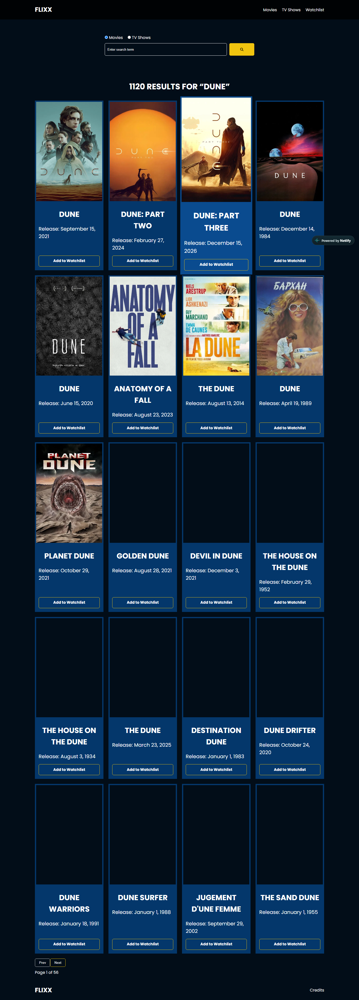
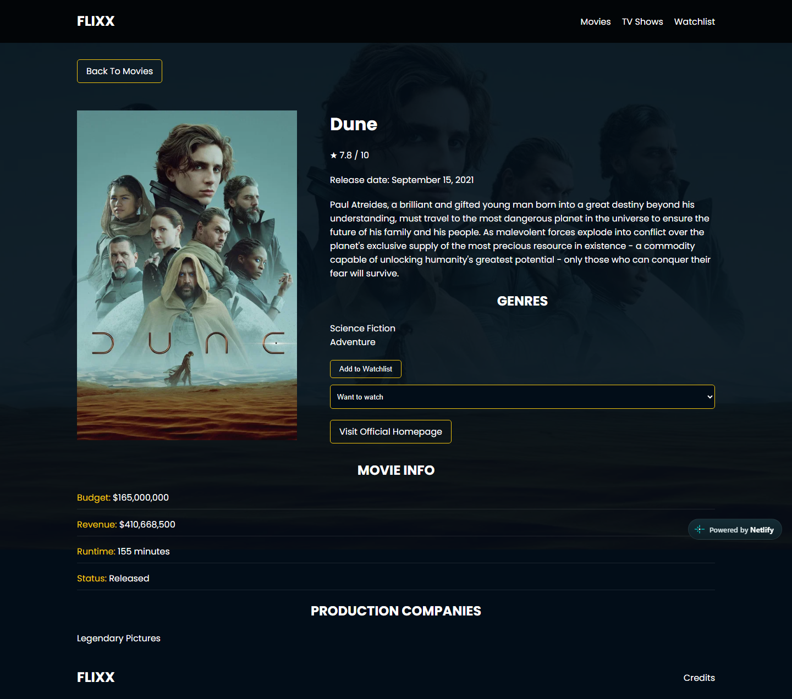
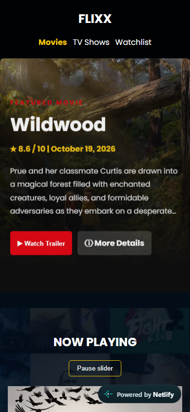

# Flixx portfolio showcase

## Project snapshot

**Flixx** is a vanilla JavaScript movie and TV discovery experience that turns a course project into a deployable, failure-aware portfolio application. It keeps the familiar dark cinema visual identity while adding a server-side API boundary, durable browser-local watchlist, accessible interactions, responsive layouts, and automated quality checks.

- **Live demo:** [flixx-benz.netlify.app](https://flixx-benz.netlify.app)
- **Repository:** [github.com/benzbago/Flixx-App](https://github.com/benzbago/Flixx-App)
- **Frontend:** HTML, CSS, and JavaScript ES modules
- **Runtime:** Netlify static hosting plus one serverless function
- **Data:** TMDB, with no paid service, user account, or database

## The problem

A tutorial application can demonstrate syntax while still failing common production scenarios: a leaked browser API key, unchecked HTTP responses, race conditions, missing fields, unsafe text rendering, inaccessible modal focus, and UI state that disappears between pages. The portfolio iteration focused on those less-visible engineering concerns without replacing the original stack or visual character.

## Origin and extensions

The course foundation comes from Brad Traversy's **Modern JavaScript From the Beginning 2.0** and includes the core movie and TV pages, TMDB browsing and search flow, details, pagination, styling, and carousel concept.

The featured hero and trailer modal began as original additions. The portfolio-ready work extends the app with a Netlify Function proxy, request-state handling, safe DOM construction, a versioned watchlist, watched statuses and filters, responsive shared cards, accessibility and reduced-motion behavior, security headers, regression tests, CI, and deployment guidance. This distinction preserves the tutorial credit while making the later engineering work reviewable.

## Verified user journeys

The screenshots below were captured from the public production deployment on October 31, 2026. The browser profile was isolated for the capture; watchlist entries were added through visible app controls, not by writing directly to `localStorage`.

### Discover current titles

The homepage uses one now-playing response for both the featured hero and carousel. The production capture shows live TMDB content, a trailer action, a detail link, and a carousel pause control.

### Search and inspect details

The production search for “Dune” returned 1,120 results at capture time. Results preserve the search context for pagination, expose card-level watchlist controls, and use poster fallbacks when images are unavailable.

The detail page validates its URL ID before requesting data and renders metadata defensively. External homepage links are assigned only after URL validation.

### Build a private watchlist

The isolated capture contains **Dune**, **Dune: Part Two**, **Law & Order: Special Victims Unit**, and **Family Guy**. Two are marked Want to Watch and two are marked Watched. The list stays in the current browser, can be filtered by media type and status, and reports malformed stored data without silently replacing it.

### Use the same flow on mobile

At a 390 × 844 viewport, navigation, hero actions, copy, imagery, and carousel controls remain available without changing the desktop identity.

## Engineering decisions

### 1. Put the API key behind a narrow serverless boundary

The browser sends an allowlisted TMDB path and validated query values to one Netlify Function. The function owns `TMDB_API_KEY`, rejects unsupported paths and parameters, applies an upstream timeout, maps authentication and rate-limit failures, and emits route-appropriate cache headers. This prevents shipping the key in the frontend bundle while remaining compatible with Netlify's free tier.

**Tradeoff:** a proxy is not an authentication system and can still consume the site's TMDB and Netlify quotas. Stronger per-user limits would require infrastructure outside this project's account-free scope.

### 2. Treat loading and failure as first-class UI states

API helpers check `response.ok`, validate JSON shape, and normalize useful errors. Page modules render loading, empty, error, and Retry states, and loaders are released in `finally`. A reference-counted loading indicator avoids one concurrent request hiding another request's spinner.

**Tradeoff:** more explicit state code increases module count, but failures become testable and users receive an action instead of a blank page.

### 3. Render external data with safe DOM construction

Cards, details, errors, and feedback are built through DOM APIs and `textContent`. Image and homepage URLs pass through focused validation before assignment. Missing posters, backdrops, dates, episode data, and homepages receive visible fallbacks.

**Tradeoff:** DOM factories are more verbose than interpolated HTML, but they establish a consistent boundary for untrusted API text.

### 4. Keep watchlist storage local and versioned

The watchlist uses a small schema with a version, media type, ID, title, image path, date, and status. Movie and TV IDs are namespaced by type. Parsing failures are surfaced and the original value is left untouched rather than silently discarding a user's list.

**Tradeoff:** local storage makes the feature private and free, but there is no cross-device sync, recovery, or multi-user support.

### 5. Design interaction details for keyboard and motion preferences

The trailer modal traps focus in both directions, recalculates focusable controls after asynchronous updates, restores focus, marks background content inert, and ignores stale responses. Carousel autoplay can be paused and starts disabled when reduced motion is preferred. Shared card actions remain at a consistent bottom edge with 44-pixel controls.

**Tradeoff:** Swiper and YouTube embeds retain some third-party behavior, so the app provides controls and fallbacks rather than complete ownership of those surfaces.

## Validation evidence

| Category             | Evidence                                                                                                                                                                                                       |
| -------------------- | -------------------------------------------------------------------------------------------------------------------------------------------------------------------------------------------------------------- |
| Source review        | Current `main` at `766d7d3` was inspected, including page modules, API utilities, watchlist and trailer modules, Netlify function/configuration, tests, and CI workflow.                                       |
| Live production      | Homepage, real movie search, detail navigation, movie and TV watchlist additions, status changes, and 390-pixel mobile rendering were exercised in an isolated Chromium context against the public deployment. |
| Screenshot review    | All five PNGs were opened and visually inspected for loaded content, readable layout, and correct state before inclusion.                                                                                      |
| Mocked automation    | The repository contains Node/JSDOM unit coverage and Playwright/axe browser coverage using deterministic mocked TMDB responses. These suites were inspected but not rerun for this documentation-only change.  |
| Documentation checks | Markdown formatting, links and image paths, changed-file scope, credential scan, and `git diff --check` are run before handoff.                                                                                |

Trailer playback was not included as screenshot evidence because the core request prioritized a small, non-redundant set and YouTube availability can change independently. The modal implementation and mocked regression coverage were inspected; live playback was not reverified in this documentation pass.

## Portfolio card copy

### Short version

**Flixx — resilient movie discovery in vanilla JavaScript.** A responsive TMDB app with a Netlify API proxy, accessible trailer modal, browser-local watchlist, defensive rendering, automated tests, and CI.

### Expanded version

I evolved a course-based movie browser into a portfolio-ready vanilla JavaScript application without replacing its original visual identity. The result adds a server-side TMDB proxy, robust loading and error states, safe DOM rendering, an accessible asynchronous trailer modal, a versioned movie/TV watchlist, responsive shared cards, Playwright and unit coverage, and a Netlify deployment workflow.

## Interview talking points

- Why a Netlify Function was the smallest useful security boundary for a static app—and what it does not protect against.
- How a request counter solves concurrent-spinner races better than a single Boolean.
- Why stale-response checks matter when a modal can be closed or reopened before a fetch completes.
- How malformed local storage can be reported without destroying recoverable user data.
- Where safe DOM construction and URL validation reduce trust in third-party API content.
- How mocked API responses create repeatable failure-path tests while live production checks cover integration reality.
- Why the project kept vanilla JavaScript and browser-local state instead of adding a framework, account system, or database.

## Current constraints

The app depends on TMDB data and YouTube embed availability, the watchlist does not sync, the serverless proxy is subject to provider quotas and cold starts, and live upstream behavior cannot be made deterministic. Those boundaries are documented rather than hidden because they shape the design and its test strategy.
